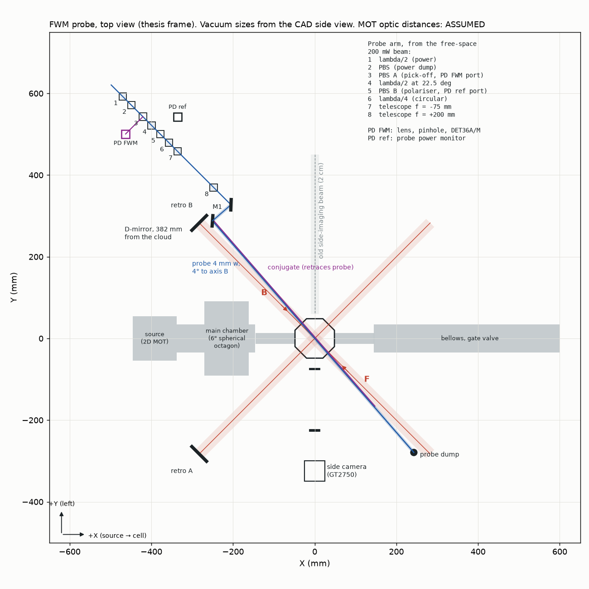
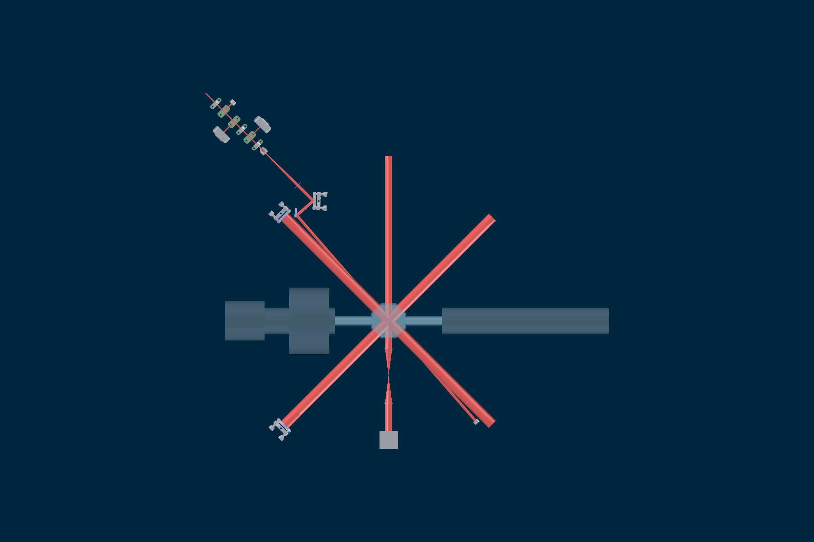
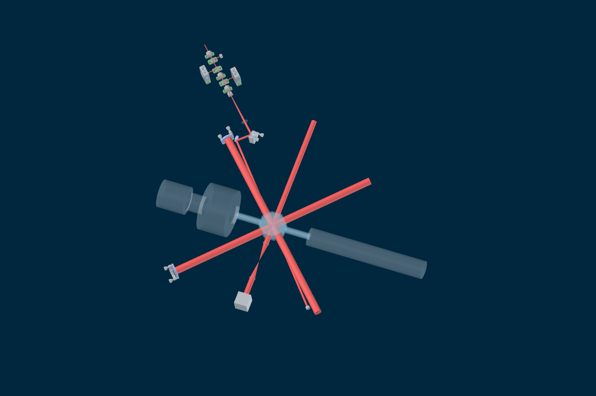
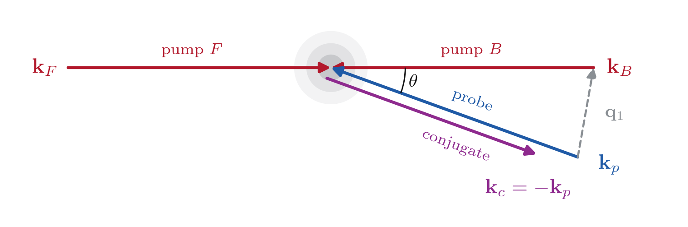
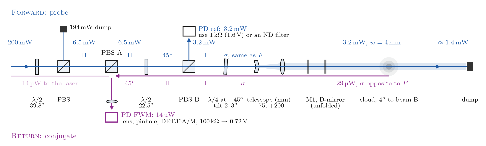
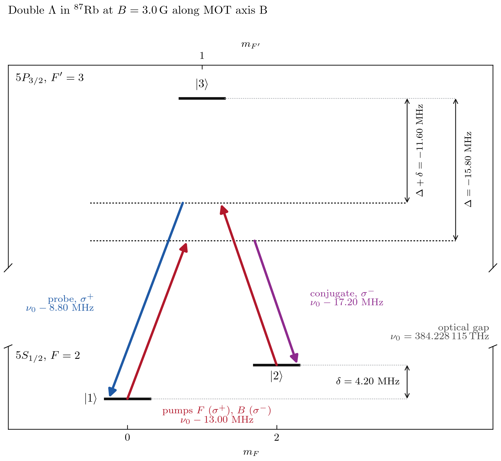

# FWM probe layout at the octagon cell

Backward four-wave mixing with the retro-reflected MOT beams as pumps. The probe crosses the cloud at 4° to one horizontal MOT axis (axis B). The conjugate comes back along the probe, and a two-PBS pick-off sends half of it to a photodiode.



`fwm_probe_plan.png` comes from `python geometry.py --plot` and needs only numpy and matplotlib. The FreeCAD renders below come from `build_in_freecad.py` (FreeCAD 1.1 and PyOpticL, built on 26 Oct 2026).

| Top view (FreeCAD) | Isometric view (FreeCAD) |
|---|---|
|  |  |

In the PyOpticL trace, every probe part sits on its beam:
- The power λ/2 at 39.8° leaves 6.46 mW after the power PBS. The PBS sends 193.5 mW to its dump.
- PBS B sends 3.23 mW to the cloud and 3.23 mW to PD ref.
- The conjugate (28.9 µW) passes PBS B whole. PBS A reflects 14.5 µW into PD FWM.

`output/beam_segments.json` lists each segment.

## Files

| File | What it does | Needs |
|---|---|---|
| `geometry.py` | All positions, the clearance checks, and the plan view (`--plot`) | numpy, matplotlib |
| `polarisation.py` | Polarisation of the pumps, the probe and the returning conjugate (3D Jones model) | numpy |
| `fwm_probe_layout.py` | PyOpticL 3D layout, built from `geometry.py` and `polarisation.py` | FreeCAD + PyOpticL |
| `build_in_freecad.py` | Builds the layout, saves `output/fwm_probe_table.FCStd`, renders `fwm_probe_top.png` and `fwm_probe_iso.png` | FreeCAD + PyOpticL |
| `fwm_diagrams.py` | Diagrams A, B and C in `figures/` (PDF and PNG) | matplotlib, TeX Live |

```
python optics/fwm_probe/geometry.py --plot
python optics/fwm_probe/polarisation.py --forward-pump sigma+
FreeCAD.exe optics/fwm_probe/build_in_freecad.py
python optics/fwm_probe/fwm_diagrams.py     # needs latex.exe on PATH
```

## Diagrams

`fwm_diagrams.py` reads every number from `geometry.py`, `polarisation.py` and `reports/2026-10-25_mot_characterisation/fwm_model.json`. Run `fwm_model.py` again before it if you change the model inputs.

**A. Wave vectors.** In the pump frame, seen from above. F and B enter the cloud from opposite sides. The probe enters on the same side of B as on the table, with the 4° angle enlarged to 20°. The pumps are a retro-reflected pair, so the conjugate leaves along −k_p, back towards the probe source, for any probe angle.



**B. Probe optics, unfolded.** The forward probe is on the line, and the returning conjugate is below it. The return is circular until the λ/4, H through PBS B, and 45° after the λ/2 at 22.5°.



**C. Frequencies and the double Λ.**
- The AOMs double-pass from the 180 MHz lock. The lock is 46.7 MHz below the F′=2/3 crossover.
- The double Λ in Rb-87 at 3 G, with the quad off. The pump F (σ⁺) takes |1⟩ = |F=2, m=0⟩ to a level 15.80 MHz below |3⟩ = |F′=3, m′=1⟩, and the conjugate (σ⁻) leaves the atom in |2⟩ = |F=2, m=2⟩. The pump B (σ⁻) then takes |2⟩ up, and the probe (σ⁺) returns the atom to |1⟩.
- The Raman resonance needs δ = 4.20 MHz, so set the imaging AOM to 85.60 MHz. If F is σ⁻ or the field is reversed, use 81.40 MHz.



## Table frame (thesis axes)

S. Tempone-Wiltshire, PhD thesis (2019), Sec. 4.1.5. The origin is the cloud.

- **+X** runs along the differential pumping tube, from the source to the science cell. The main chamber is at −X. The bellows and the gate valve are at +X.
- **+Y** is to the left when you look along +X. The old side-imaging beam enters from +Y. The side camera is at −Y.
- **+Z** is up.

| Beam | Direction | Source |
|---|---|---|
| Side imaging | along Y, 2 cm 1/e² diameter, f = 75 mm lens 75 mm from the atoms | Thesis Sec. 7.5.1, user (beam left, camera right) |
| MOT axis A | 45° ↔ 225°. The retro is at the right-source port (225°). | Thesis: horizontal MOT beams at 45° to the imaging axis. User (26 Oct 2026): retro A clears the main chamber. |
| MOT axis B | 135° ↔ 315°. The input is at the right-valve port, the retro at the left-source port. | User |
| Probe | travels at 311°, 4° from the retro beam B, from the left between beam B and the imaging beam | User |

The old face numbers (1–8) are not used. They were not documented.

## Values and their sources

| Value | Model | Source |
|---|---|---|
| Cell | 40 mm square flats, 4 mm glass, 96.6 mm across the flats, seals on the X axis | Thesis Sec. 4.1.4 |
| MOT beams | 28 mm 1/e² diameter. Clear radius 16.8 mm (an aperture of 1.2× the diameter passes 95 %) | Thesis Sec. 5.4.2 |
| MOT retro | One HR-coated λ/4 for each beam, drawn as a 2" optic | Thesis Sec. 5.4.2. Size ASSUMED |
| Probe input | 3 mm 1/e² diameter, free space, about 200 mW | Thesis Sec. 4.3.1, user |
| Probe at the cloud | 4 mm 1/e² radius, 3.2 mW, 100 µs pulses | `fwm_model.py` (report 2026-10-25, Sec. 5) |
| MOT optics distances | 400 mm from the cloud | ASSUMED. Measure them. |
| Seal tubes, vacuum hardware | 26 mm glass tubes, 97 mm to the 2¾" CF flanges. Main chamber (Kimball 6" spherical octagon, 6" faces on ±X) from 161 to 270 mm at −X, 91 mm half-width. Source from 338 to 445 mm. | Thesis Sec. 4.1.4–4.1.5 for the parts and their order. Sizes from the SolidWorks side view from the user, scaled by the cell width (1.486 mm/px). The 2¾" flanges measure 69.9 mm (standard: 69.85 mm). Sizes along Y are not in a side view: `geometry.py` uses the 8-fold symmetry of the octagon, and marks the source width ASSUMED. |

The thesis also gives the bias-coil formers (X: 170 mm square, 85 mm apart; Y: 200 mm square, 100 mm apart). An 85 mm gap is smaller than the 96.6 mm cell, so one of these numbers does not match the build. The plan does not draw the coils. Inside 200 mm of the cloud, the probe stays inside the MOT beam's footprint, so it passes every coil gap that the MOT beam passes.

## Probe path

Upstream to downstream, along the main arm (parallel to MOT beam B, 82 mm from its axis):

| # | Part | Setting |
|---|---|---|
| 1 | λ/2 (power) | 39.8° from its zero: 6.5 mW through the power PBS |
| 2 | PBS (power) | Dump the reflection. It carries up to 200 mW. |
| 3 | PBS A (pick-off) | Same axes as PBS B. Its fourth port goes to PD FWM: lens, pinhole, DET36A/M at 100 kΩ. |
| 4 | λ/2 | 22.5° from its zero |
| 5 | PBS B (polariser) | 3.2 mW to the arm, 3.2 mW to PD ref. Tilt it 1–2°. |
| 6 | λ/4 | −45° if F is σ+, +45° if F is σ− (`polarisation.py`). Tilt it 2–3°. |
| 7, 8 | Galilean telescope, f = −75 mm then +200 mm | 1.5 mm → 4 mm radius. It sits after the λ/4, so PBS B rejects its reflections. |
| — | M1 (1") | 43° incidence |
| — | D-mirror (1") | 45° incidence. Straight edge 6 mm (1.5 w) from the probe, on the MOT side |
| — | Dump | On the probe beyond the cloud, before the axis-B input optics |

Polarisation (`polarisation.py`). The probe runs near the retro beam B. So B is the writing beam W of Moretti *et al.*, *Phys. Rev. A* **79**, 023825 (2009), and F is the read beam:
- The probe has the same σ as F about the F direction. The conjugate has the opposite σ.
- The conjugate returns horizontal through the λ/4, so PBS B passes it. The λ/2 turns it to 45°, and PBS A reflects half of it to PD FWM.
- Mirror-like reflections from beyond the λ/4 return vertical, and PBS B dumps them.
- Leave out an extra λ/2 after PBS B. Its face reflections return horizontal and leak to PD FWM. Use one only to correct a coating retardance (`--mirror-retardance-deg`).

## What to measure before you trust the plan

`geometry.py` gives the conditions for a 4° probe with a 4 mm waist:

1. **Axis-B retro optic: 394 mm or more from the cloud.** Then the D-mirror fits in front of it (at about 382 mm). The other option is 622 mm or more, where the probe passes outside the retro mount. Without the telescope (w = 1.5 mm), the limits are lower: the D-mirror needs 336 mm.
2. **Axis-B input optic: 378 mm or more from the cloud.** Otherwise the transmitted probe enters the MOT input optics.
3. The real retro-optic size and mount. Enter them in `geometry.py` and run it again.

With the MOT optics at 400 mm, retro A is at (−283, −283) mm. Its mount clears the main chamber by 155 mm. Each MOT beam clears the vacuum hardware by 9 mm (95 % aperture). That closest point is the glass seal tube beside the cell, not the main chamber.

## Limits of the model

- PyOpticL keeps one Jones vector for each beam and does not change it at a mirror. Use `polarisation.py` for the polarisation results. The PyOpticL build agrees with it for the two PBS cubes.
- PyOpticL checks beam centres, not beam widths. `geometry.py` does the width checks.
- All beams are in one horizontal plane. The model has no table grid, posts or beam height.

## Use it without Claude

You need three things. Total install time is about 20 minutes.

| Package | Where it comes from | Used by |
|---|---|---|
| Python 3 + numpy | Any Python (`pip install numpy`) | `geometry.py`, `polarisation.py` |
| FreeCAD 1.x | Installer from https://www.freecad.org/downloads.php. It includes its own Python and numpy. | `build_in_freecad.py`, `fwm_probe_layout.py` |
| PyOpticL | FreeCAD Addon Manager (custom repository) | `fwm_probe_layout.py` |

FreeCAD and PyOpticL are not pip packages, so `pip install` cannot install them.

### Install (once)

1. Install FreeCAD 1.x with the Windows installer. Use the default folder, `C:\Program Files\FreeCAD 1.1`.
2. In FreeCAD, open Edit > Preferences > Addon Manager > Custom repositories. Add `https://github.com/UMassIonTrappers/PyOpticL.git` with branch `main`.
3. Open Tools > Addon Manager, find PyOpticL, and install it. Restart FreeCAD. As an alternative, clone the repository into the FreeCAD Mod folder:
   `git clone https://github.com/UMassIonTrappers/PyOpticL.git "%APPDATA%\FreeCAD\v1-1\Mod\PyOpticL"`
4. Make sure that "PyOpticL" shows in the workbench list.

### Change the design and rebuild

1. Edit the numbers in `geometry.py` (positions, angle, sizes). Each value has a comment.
2. Run the checks: `python optics/fwm_probe/geometry.py`. Fix any line that says `COLLIDES` before you continue.
3. For polarisation settings, run `python optics/fwm_probe/polarisation.py --forward-pump sigma+`.
4. Build the 3D model in one of two ways:
   - In FreeCAD: Macro > Macros... Set "User macros location" to this folder, select `build_in_freecad.py`, and click Execute.
   - From a terminal: `"C:\Program Files\FreeCAD 1.1\bin\FreeCAD.exe" optics\fwm_probe\build_in_freecad.py`
5. Open `output/fwm_probe_table.FCStd`. The build also writes `fwm_probe_top.png` and `fwm_probe_iso.png` in this folder, and `output/beam_segments.json` (every beam segment, with its start, direction, length and power).

You can run the macro again after each edit. It reloads `geometry.py`, `polarisation.py` and `fwm_probe_layout.py`, and it replaces the old document.

If the build fails, read `output/build_status.txt`. It contains the Python error.

If you use a portable FreeCAD `.7z`, extract it to a short path such as `C:\FreeCAD`. A long path breaks numpy (Windows has a 260-character path limit).
