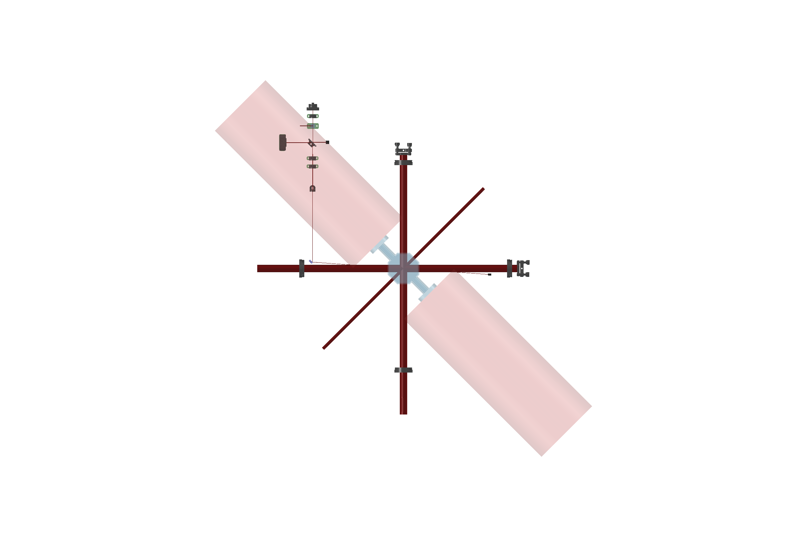

# FWM probe layout at the octagon cell

Backward four-wave mixing with the retro-reflected MOT beam 1-5 as the pumps. The probe crosses the cloud at 4.0° to the forward pump. The FWM signal comes back along the probe path and a 90:10 plate sends it to a photodiode.

> **Known problem (do not build the probe arm yet).** Faces 4 and 8 carry the vacuum connections (thesis Sec. 4.1.4). The probe arm at x = −280 mm crosses that axis at y = 280 mm. `geometry.py` reports seven probe parts inside the assumed 110 mm vacuum keep-out (pink in the picture). The probe angle, the D-mirror and the polarisation settings are not affected. Only the arm route must change.



## Files

| File | What it does | Needs |
|---|---|---|
| `geometry.py` | All positions, the probe angle and the clearance checks | numpy |
| `polarisation.py` | Polarisation of the pumps, the probe and the returning signal (3D Jones model) | numpy |
| `fwm_probe_layout.py` | PyOpticL 3D layout, built from `geometry.py` and `polarisation.py` | FreeCAD + PyOpticL |
| `build_in_freecad.py` | Builds the layout, saves `output/fwm_probe_table.FCStd`, renders the views | FreeCAD + PyOpticL |

```
python optics/fwm_probe/geometry.py
python optics/fwm_probe/polarisation.py --forward-pump sigma+
FreeCAD.exe optics/fwm_probe/build_in_freecad.py
```

Install PyOpticL in FreeCAD with the Addon Manager (see the [PyOpticL README](https://github.com/UMassIonTrappers/PyOpticL)). Or set `PYOPTICL_PATH` to a clone of the repository.

## Table frame

- The origin is the cloud. +x runs along MOT axis 1-5, from face 1 to face 5. +y runs along MOT axis 3-7.
- The forward pump F enters through face 1. The retro optics after face 5 return it as the backward pump B.
- Side imaging uses faces 2 and 6.
- Faces 4 and 8 carry the glass-to-metal seals. The vacuum system runs along this axis: the main chamber on one side, bellows and a gate valve on the other.

## Science cell

Values from S.'s PhD thesis, Section 4.1.4:

> "The Science chamber, shown in figure. 4.3b, consists of an octagonal glass cell made from 4 mm thick glass, with 40 mm (external) square optical flats on 6 sides, and glass to metal seals attached to the other two faces that oppose each other."

| Value | Model | Source |
|---|---|---|
| Side of each flat | 40 mm | Thesis |
| Height | 40 mm (square flats) | Thesis |
| Across the flats | 96.57 mm = 40 × (1 + √2) | Calculated |
| Glass thickness | 4 mm | Thesis |
| Seal faces | 4 and 8 | Thesis (two opposite faces), matched to your face numbers |
| Seal tube | 25.4 mm diameter, 50 mm long | ASSUMED |
| Seal flange | 2¾" CF (69.85 mm diameter) | Thesis names a 6" to 2¾" reducer. Flange size on the cell is ASSUMED |
| Vacuum keep-out | 110 mm radius, 600 mm each side | ASSUMED (a 6" CF flange has a 101.6 mm radius) |

The probe crosses faces 1 and 5 at 3.4 mm from the flat centre, 16.6 mm from the flat edge.

## Probe path (from the fibre)

| # | Part | Table position (mm) | Setting |
|---|---|---|---|
| 1 | Fibre collimator, about 2 mm beam diameter | (−279.0, 499.6) | Beam travels −y |
| 2 | ½" HWP in RSP05 | y = 469.6 | Maximum transmission through the PBS |
| 3 | ½" PBS cube | y = 439.6 | Transmits the horizontal state (clean-up polariser) |
| 4 | 1" non-polarising plate, R:T 90:10, at 45° | y = 389.6 | Transmits 10 % of the probe. Reflects 90 % of the signal to the photodiode. |
| 5 | Beam dump | 40 mm towards +x from the plate | Stops the 90 % forward reflection |
| 6 | Photodiode (PDA10A2) | 80 mm towards −x from the plate | FWM signal. Beat note later. |
| 7 | ½" HWP in RSP05 | y = 339.6 | 0° (see below) |
| 8 | ½" QWP in RSP05 | y = 314.6 | ±45° (see below) |
| 9 | ½" lens, f = 500 mm | y = 238.9 | Focus at the cloud, w₀ ≈ 124 µm |
| 10 | ½" D-shaped mirror | (−280.0, 19.6) | Face normal at 43.0°. Straight edge 1.5 mm from the probe, on the MOT side. |
| 11 | Beam dump, 6 mm | x = 260, y = −18.2 | Stops the transmitted probe before the retro QWP |

Angles are from horizontal, counterclockwise when you look from the fibre towards the cell.

The 3 mm plate moves the transmitted beam 0.99 mm towards −x. Thus the fibre is 0.99 mm to the +x side of the D-mirror.

## Why 4.0°

1. `geometry.py` puts the D-mirror at x = −280 mm, inside the 300 mm free zone before the MOT input optics.
2. The mirror's straight edge and the 6 mm substrate behind it must stay outside the 12.7 mm MOT beam edge. The smallest angle with a 1 mm margin is 3.86°.
3. The layout uses 4.0°, which gives a 1.7 mm margin. This is the angle of Lezama, Cardoso & Tabosa, *Phys. Rev. A* **63**, 013805 (2001).

A kinematic mount behind a 45° fold mirror at this position clips the MOT beam. Hold the D-mirror from its round side, away from the MOT beam, with a D-mirror mount. The model shows the mirror without a mount.

## Polarisation

`polarisation.py` gives these results:

| Beam | State | Source |
|---|---|---|
| Forward pump F | Circular, set by the MOT input QWP | — |
| Backward pump B | Opposite σ to F (same helicity) | QWP + mirror retro |
| Probe | Circular, opposite σ to F | Moretti *et al.*, *Phys. Rev. A* **79**, 023825 (2009), Fig. 1 |
| FWM signal | Circular, opposite σ to the probe | Moretti *et al.* 2009, Fig. 1 |

- If F is σ+ about +x, set the probe QWP to +45°. If F is σ−, set it to −45°. Leave the HWP at 0°. These angles are for an ideal D-mirror.
- A real mirror coating adds an s/p phase at 45°. Use `--mirror-retardance-deg` to find the HWP and QWP angles that correct it. The probe stays circular for any retardance.
- The signal returns through the waveplates in the same linear state as the input probe, for any mirror retardance. This is phase conjugation. So a PBS cannot separate the signal, and the 90:10 plate is necessary. Lezama *et al.* used a 50/50 splitter for the same reason.

## Before you build it

1. Measure the circular state of the MOT beam that enters face 1. Use a QWP and a PBS of known orientation. Then run `polarisation.py --forward-pump sigma+` or `sigma-`.
2. Measure the positions of the MOT input and retro optics, and enter them in `geometry.py`. Then run `geometry.py` again.
3. Choose a fibre collimator that gives about a 2 mm beam diameter. The waist at the cloud is w₀ = λf/(πw_in). The model uses the PAF2-A4A body only as a placeholder.
4. Set the probe power low. Lezama *et al.* used 0.7 mW/cm². At a 124 µm waist that is about 0.1 µW at the cloud, or about 1 µW before the 10 % plate.

## Limits of the model

- PyOpticL traces polarisation only in a simple way. Mirrors do not change the state, and it shows the returning signal split 50/50 at the PBS. Use `polarisation.py` for all polarisation results.
- PyOpticL checks beam centres, not beam widths. `geometry.py` does the width clearance checks.
- The seal tube, the flange and the vacuum keep-out sizes are placeholders. Measure them and enter them in `geometry.py`.
- The model does not include the bias and quadrupole coils. The thesis gives 170 mm and 200 mm square bias-coil formers around the cell. The probe uses the same coil openings as the MOT beam.
- The imaging beam size and the MOT optics positions are placeholders.
- All beams are in one horizontal plane. The model does not include the table grid, posts or beam height.

## Use it without Claude

You need three things. Total install time is about 20 minutes.

| Package | Where it comes from | Used by |
|---|---|---|
| Python 3 + numpy | Any Python (`pip install numpy`) | `geometry.py`, `polarisation.py` |
| FreeCAD 1.x | Installer from https://www.freecad.org/downloads.php. It includes its own Python and numpy. | `build_in_freecad.py`, `fwm_probe_layout.py` |
| PyOpticL | FreeCAD Addon Manager (custom repository) | `fwm_probe_layout.py` |

FreeCAD and PyOpticL are not pip packages, so `pip install` cannot install them.

### Install (once)

1. Install FreeCAD 1.x with the Windows installer. Use the default folder, `C:\Program Files\FreeCAD 1.1`.
2. In FreeCAD, open Edit > Preferences > Addon Manager > Custom repositories. Add `https://github.com/UMassIonTrappers/PyOpticL.git` with branch `main`.
3. Open Tools > Addon Manager, find PyOpticL, and install it. Restart FreeCAD.
4. Make sure that "PyOpticL" shows in the workbench list.

### Change the design and rebuild

1. Edit the numbers in `geometry.py` (positions, angle, sizes). Each value has a comment.
2. Run the checks: `python optics/fwm_probe/geometry.py`. Fix any line that says `COLLIDES` before you continue.
3. For polarisation settings, run `python optics/fwm_probe/polarisation.py --forward-pump sigma+`.
4. Build the 3D model in one of two ways:
   - In FreeCAD: Macro > Macros... Set "User macros location" to this folder, select `build_in_freecad.py`, and click Execute.
   - From a terminal: `"C:\Program Files\FreeCAD 1.1\bin\FreeCAD.exe" optics\fwm_probe\build_in_freecad.py`
5. Open `output/fwm_probe_table.FCStd`. The build also writes `fwm_probe_top.png`, `fwm_probe_iso.png`, and `beam_segments.json` (every beam segment, with its start, direction and length).

You can run the macro again after each edit. It reloads `geometry.py`, `polarisation.py` and `fwm_probe_layout.py`, and it replaces the old document.

If the build fails, read `output/build_status.txt`. It contains the Python error.

If you use a portable FreeCAD `.7z`, extract it to a short path such as `C:\FreeCAD`. A long path breaks numpy (Windows has a 260-character path limit).
