# MOT optimisation and first FWM test plan (22 Oct 2026)

## Summary

- **Source LED:** the shot-to-shot MOT instability came from the source LED. Each pulse drained Rb from the source cell walls. With `source_mot_led_enable` = False, 8 back-to-back shots scatter by 1 % and don't drift.
- **3D MOT:** it loads with τ = 4.0 s to a plateau of N_f ≈ 1.2 × 10¹⁰. That is enough for a first four-wave-mixing (FWM) attempt.
- **Scan run:** most of the automated 2D MOT scan run was spoiled by the repump laser drifting off over about 30 minutes. Only the push scan, taken after the repump was corrected by hand, is usable.
- **First FWM test:** the plan in this report (the side imaging beam as the probe) is out of date. See section 3.

N_f is the background-subtracted fluorescence count from lyse `fluoro_frame`. It is a relative measure, not a calibrated atom number.

## 1. MOT stability

| Sequence | Settings | N_f (×10⁹) | Result |
|---|---|---|---|
| 0015 | LED on, no wait | 6.0 → 0.25 over 8 shots | Collapses 25× |
| 0016 | LED on, 10 s wait | 0.5 → 1.5 | Recovers over about 40 s, still drifting |
| 0017 | LED off, no wait | 5.3 → 4.5 | 5 % scatter, −14 % drift |
| 0018 | LED off, no wait (start of the scan run) | 6.0 ± 0.06 | 1 % scatter, no drift |

The stability check in `tools/mot_scan.py` now fails a run if the scatter or the fitted change from first to last shot is over 20 %. The check used to test only whether N_f kept falling in shot order. That rejected 0017, even though it fell by only 2 % per shot. The script also now warns at start-up if the LED is enabled.

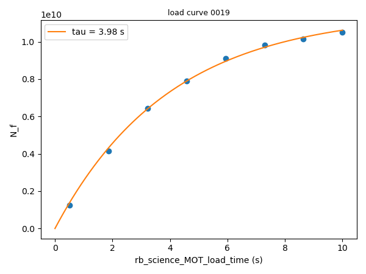

From the load curve: τ = 3.98 s, plateau 1.16 × 10¹⁰, loading rate 2.9 × 10⁹ s⁻¹. Scans use a load time of τ/2 = 2 s, where N_f is most sensitive to the loading rate. FWM shots should load for about 6–8 s, which reaches 80–90 % of the plateau.

## 2. Automated 2D MOT scan run (logs `20261022_170930`)

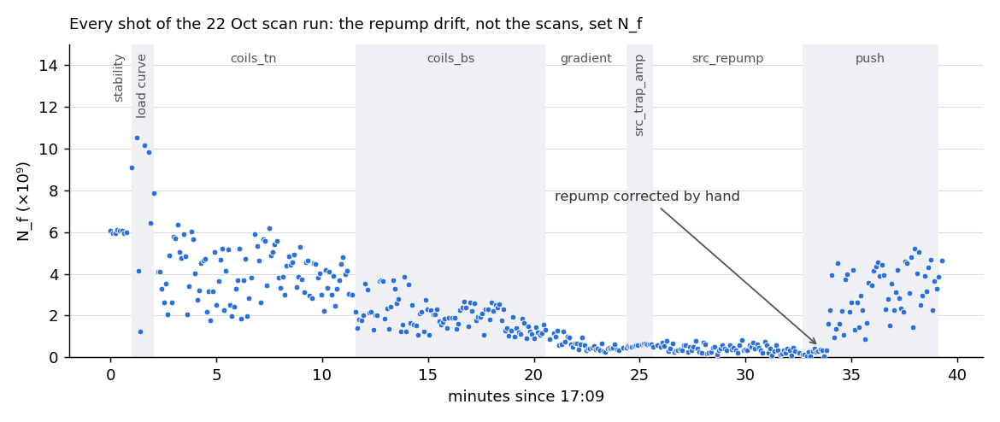

N_f fell steadily from about 4.5 × 10⁹ to 0.2 × 10⁹ through coils_tn, coils_bs, gradient, src_trap_amp and src_repump. It recovered as soon as the repump was corrected by hand. The final check shot gave 4.65 × 10⁹, matching the 4.6 × 10⁹ the load curve predicts at 2 s. So the loss was all repump; the scanned parameters weren't responsible. The decline was gradual, so the repump frequency walked slowly rather than losing lock suddenly.

| Scan | Fitted result | Applied | Verdict |
|---|---|---|---|
| coils_tn | N_f rises with the top coil. Peak at or beyond 9.8 V, close to the 10 V supply limit. | No | Usable trend (taken early). The top coil has no room left. |
| coils_bs | Edge optima, falling N_f | No | Spoiled by the drift |
| gradient | Edge optimum, range clipped by the top coil | No | Spoiled by the drift |
| src_trap_amp | 0.4527 from a fit whose width hit its limit (a straight line) | **Yes. Revert to 0.5.** | Spoiled by the drift |
| src_repump | Optimum running towards 93 MHz | No | Probably the scan following the drifting laser |
| push | 0.527 amplitude, 87.4 MHz | Yes | Valid (taken after the fix) |

Scan plots (attempt 1 and the recentred attempt 2)

| | |
|---|---|
| 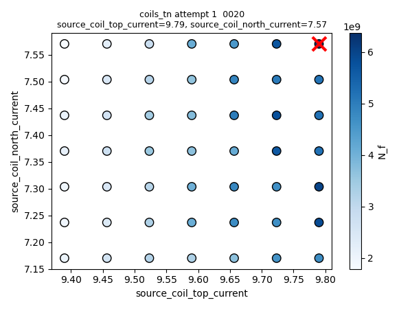 | 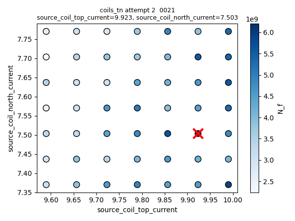 |
| 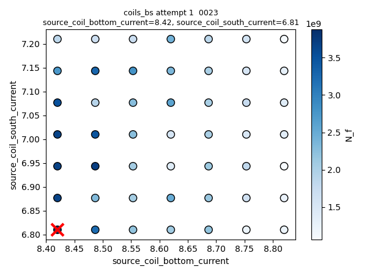 | 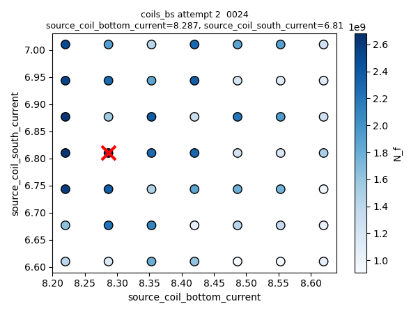 |
| 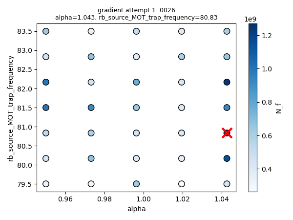 | |
| 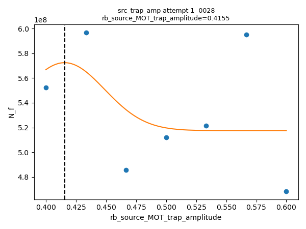 | 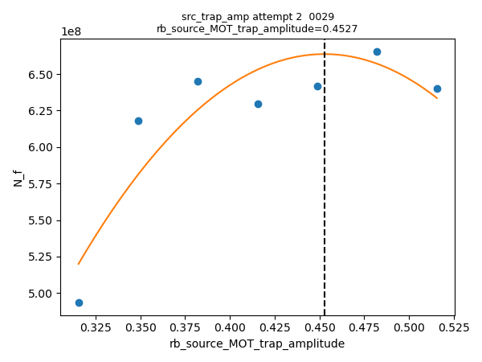 |
| 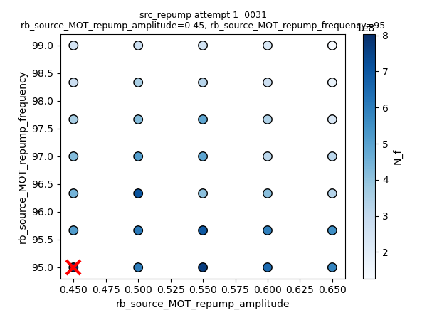 | 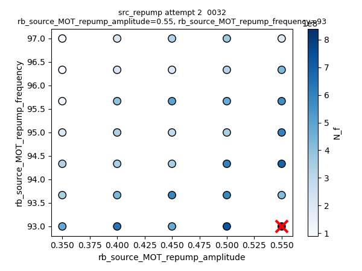 |
| 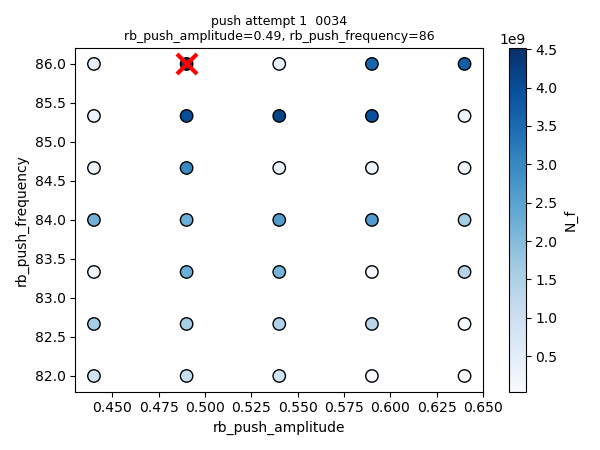 | 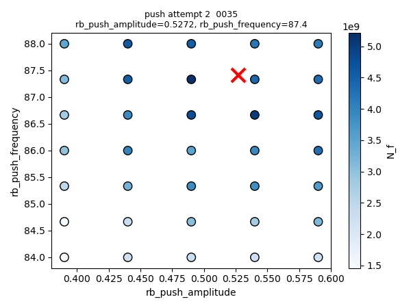 |

The per-scan fits are in [summary.jsonl](summary.jsonl).

### Next steps for the MOT

1. **Repump lock.** Put the MOGLabs error-signal and piezo monitor outputs on the DPO3054 in roll mode for 30 minutes. The traces will separate thermal drift (the piezo creeping to its limit) from a moving lock point (a DC offset on the error signal).
   - For thermal drift: give the laser 1–2 h to warm up, enclose it, and re-centre the piezo offset before long runs.
   - For a moving lock point: switch to a modulation lock on the strongest crossover.
   - Also check whether zlock can monitor or relock the repump.
2. **Re-run the optimisation** once the repump holds.
3. **`mot_scan.py` changes (done after this report):**
   - The ranges are about twice as wide (alpha unchanged).
   - The run pauses when a check shot drops below 70 % of the expected N_f. This would have stopped this run 25 minutes earlier.
   - Fits wider than twice the range are rejected.
4. **Camera framing.** The cloud sits at row 302 of 2200 and is clipped at the frame edge, so N_f is underestimated. Steer the camera and imaging beam to the cloud rather than biasing the MOT away from the beam overlap. A 7-shot scan of `z_bias_MOT_load_current` (0 to 1.5) would show whether a bias costs atoms.
5. **Further 3D MOT tuning isn't needed yet.** FWM depends on optical depth and temperature, so absorption imaging (OD) and time-of-flight (temperature) come next, then the CMOT/PGC stages.

## 3. First FWM test (out of date)

This section planned a test with the old side-imaging beam as the probe. The 200 mW beam no longer takes that path. It now runs in free space to a 4° arm beside MOT axis B. See [optics/fwm_probe/README.md](../../optics/fwm_probe/README.md) for the current layout and [the 25 Oct report, section 5](../2026-10-25_mot_characterisation/README.md) for the probe power, the detection and the Zeeman settings.

## Open items

- Repump lock diagnosis (section 2).
- Revert `rb_source_MOT_trap_amplitude` to 0.5.
- Which digital line now drives the shutter moved into the push path.
- Calibration of the quad and bias coils (G/A), to turn bias currents into cloud displacement.
- Absorption imaging (OD) and time-of-flight (temperature) after recentring the camera.
