# MOT optimisation and first FWM test plan (22 Oct 2026)

## Summary

- **Source LED:** the shot-to-shot MOT instability came from the source LED. Each pulse drained Rb from the source cell walls. With `source_mot_led_enable` = False, 8 back-to-back shots scatter by 1 % and don't drift.
- **3D MOT:** it loads with τ = 4.0 s to a plateau of N_f ≈ 1.2 × 10¹⁰. That is enough for a first four-wave-mixing (FWM) attempt.
- **Scan run:** most of the automated 2D MOT scan run was spoiled by the repump laser drifting off over about 30 minutes. Only the push scan, taken after the repump was corrected by hand, is usable.
- **First FWM test:** it needs no second laser and no change to the connection table or sequence. The plan is backward degenerate FWM, with the MOT beams as pumps and the side imaging beam as the probe. A spare PBS and half-wave plate act as a 50:50 pickoff onto the DET36A.

N_f is the background-subtracted fluorescence count from lyse `fluoro_frame`. It is a relative measure, not a calibrated atom number.

## 1. MOT stability

| Sequence | Settings | N_f (×10⁹) | Result |
|---|---|---|---|
| 0015 | LED on, no wait | 6.0 → 0.25 over 8 shots | Collapses 25× |
| 0016 | LED on, 10 s wait | 0.5 → 1.5 | Recovers over about 40 s, still drifting |
| 0017 | LED off, no wait | 5.3 → 4.5 | 5 % scatter, −14 % drift |
| 0018 | LED off, no wait (start of the scan run) | 6.0 ± 0.06 | 1 % scatter, no drift |

The stability check in `tools/mot_scan.py` now fails a run if the scatter or the fitted change from first to last shot is over 20 %. The check used to test only whether N_f kept falling in shot order. That rejected 0017, even though it fell by only 2 % per shot. The script also now warns at start-up if the LED is enabled.

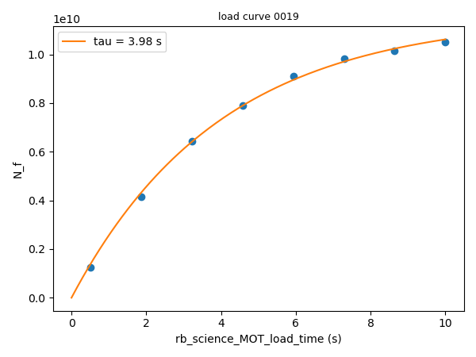

From the load curve: τ = 3.98 s, plateau 1.16 × 10¹⁰, loading rate 2.9 × 10⁹ s⁻¹. Scans use a load time of τ/2 = 2 s, where N_f is most sensitive to the loading rate. FWM shots should load for about 6–8 s, which reaches 80–90 % of the plateau.

## 2. Automated 2D MOT scan run (logs `20261022_170930`)

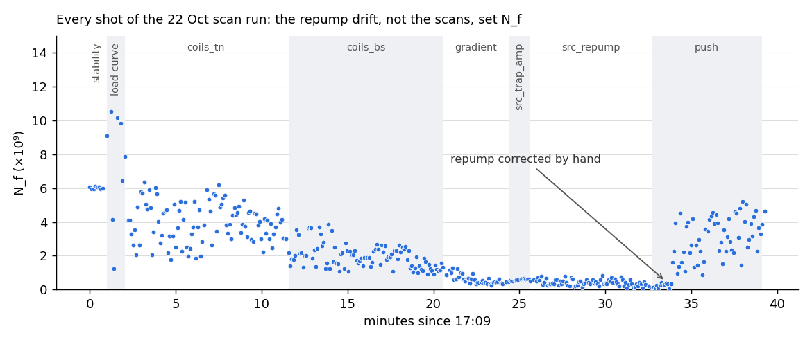

N_f fell steadily from about 4.5 × 10⁹ to 0.2 × 10⁹ through coils_tn, coils_bs, gradient, src_trap_amp and src_repump. It recovered as soon as the repump was corrected by hand. The final check shot gave 4.65 × 10⁹, matching the 4.6 × 10⁹ the load curve predicts at 2 s. So the loss was all repump; the scanned parameters weren't responsible. The decline was gradual, so the repump frequency walked slowly rather than losing lock suddenly.

| Scan | Fitted result | Applied | Verdict |
|---|---|---|---|
| coils_tn | N_f rises with the top coil. Peak at or beyond 9.8 V, close to the 10 V supply limit. | No | Usable trend (taken early). The top coil has no room left. |
| coils_bs | Edge optima, falling N_f | No | Spoiled by the drift |
| gradient | Edge optimum, range clipped by the top coil | No | Spoiled by the drift |
| src_trap_amp | 0.4527 from a fit whose width hit its limit (a straight line) | **Yes. Revert to 0.5.** | Spoiled by the drift |
| src_repump | Optimum running towards 93 MHz | No | Probably the scan following the drifting laser |
| push | 0.527 amplitude, 87.4 MHz | Yes | Valid (taken after the fix) |

<details><summary>Scan plots (attempt 1 and the recentred attempt 2)</summary>

| | |
|---|---|
| 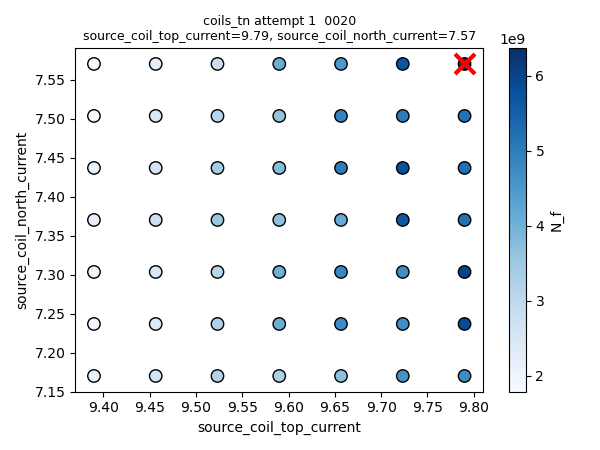 | 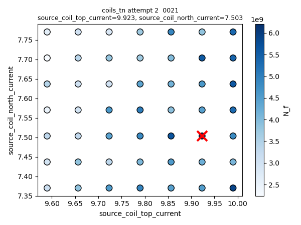 |
| 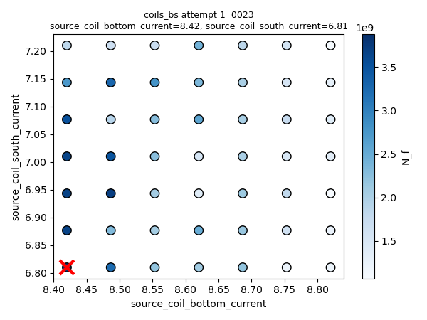 | 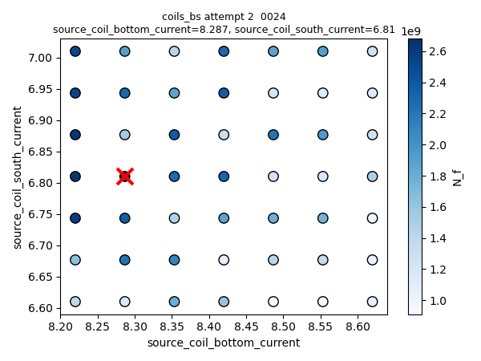 |
| 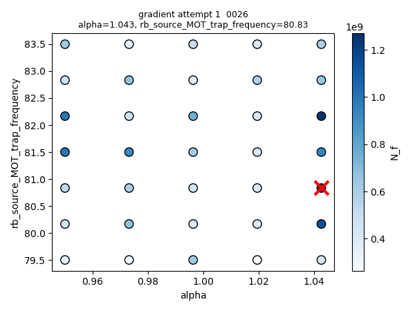 | |
| 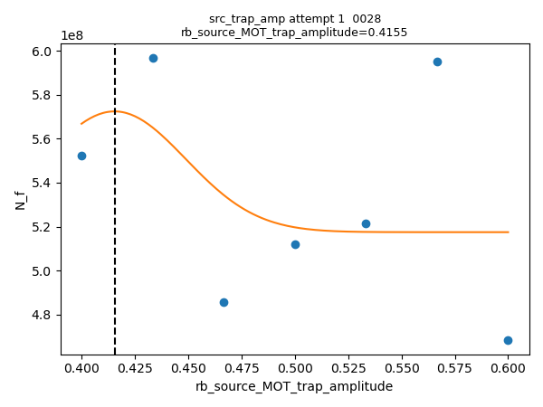 | 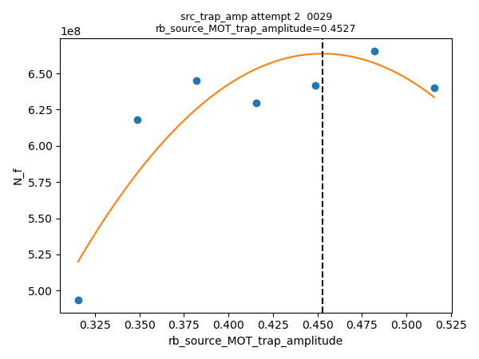 |
| 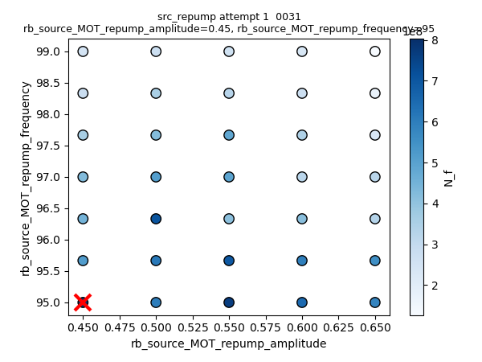 | 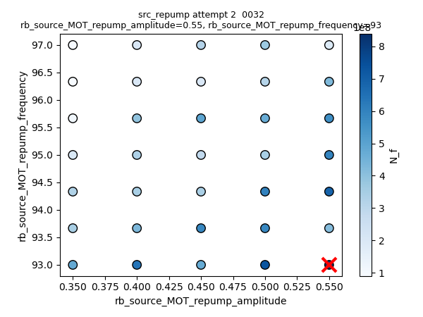 |
| 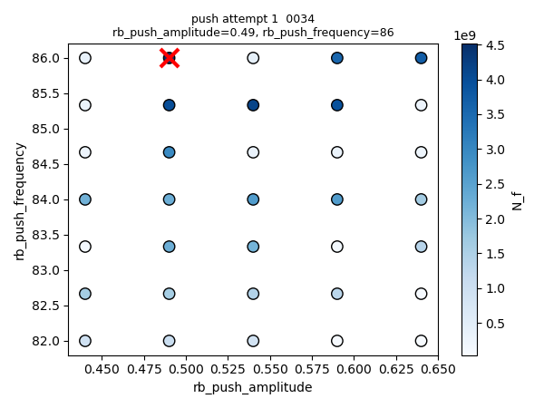 | 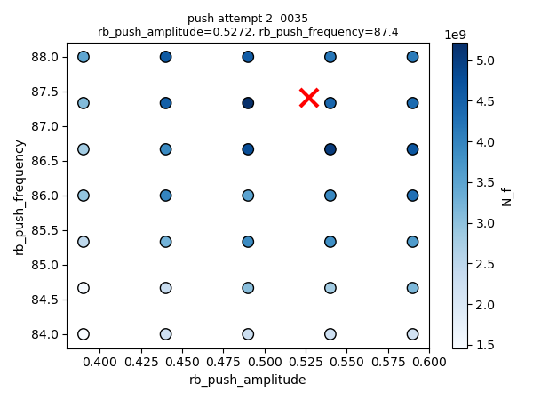 |

</details>

The per-scan fits are in [summary.jsonl](summary.jsonl).

### Next steps for the MOT

1. **Repump lock.** Put the MOGLabs error-signal and piezo monitor outputs on the DPO3054 in roll mode for 30 minutes. The traces will separate thermal drift (the piezo creeping to its limit) from a moving lock point (a DC offset on the error signal).
   - For thermal drift: give the laser 1–2 h to warm up, enclose it, and re-centre the piezo offset before long runs.
   - For a moving lock point: switch to a modulation lock on the strongest crossover.
   - Also check whether zlock can monitor or relock the repump.
2. **Re-run the optimisation** once the repump holds.
3. **`mot_scan.py` changes (done after this report):**
   - The ranges are about twice as wide (alpha unchanged).
   - The run pauses when a check shot drops below 70 % of the expected N_f. This would have stopped this run 25 minutes earlier.
   - Fits wider than twice the range are rejected.
4. **Camera framing.** The cloud sits at row 302 of 2200 and is clipped at the frame edge, so N_f is underestimated. Steer the camera and imaging beam to the cloud rather than biasing the MOT away from the beam overlap. A 7-shot scan of `z_bias_MOT_load_current` (0 to 1.5) would show whether a bias costs atoms.
5. **Further 3D MOT tuning isn't needed yet.** FWM depends on optical depth and temperature, so absorption imaging (OD) and time-of-flight (temperature) come next, then the CMOT/PGC stages.

## 3. First FWM test: backward degenerate FWM on the side imaging axis

### Why it works with the existing setup

- **Pumps:** each retro-reflected MOT pair is two counter-propagating beams, so phase matching is automatic. The signal leaves along −k_probe for any probe angle.
- **One laser:** the probe and pumps come from the same master laser, so laser frequency noise cancels and no second lock is needed.
- **Frequencies:** `imaging_push_aom` and `science_trap_aom` share the 90 MHz resonance global, so they probably have the same frequency mapping. Setting the probe AOM to 83.5 MHz (the MOT AOM frequency) should make it exactly degenerate with the pumps. Between shots it sits at 84–87.4 MHz (the push frequency).
- **Polarisation:** the existing imaging path (fibre, half-wave plate, PBS, QWP and lens in the CP06F/M assembly, 90° mirror) already throws away reflections. Light reflected from beyond the QWP comes back rotated 90° and leaves through the PBS side port. The FWM signal is a phase conjugate, so it returns in the probe's polarisation and passes back through the PBS. The repo's polarisation model, [optics/fwm_probe/polarisation.py](../../optics/fwm_probe/polarisation.py), confirms this.

### Layout

```
 fibre + HWP   ★ spare PBS   ★ HWP 22.5°   existing PBS    QWP + lens     90° mirror
  ┌──┐┃                                                    (CP06F/M)      (tilt 5–10 mrad)
  │  │┃ ═══════> ▣ ═══════════> ┃ ═══════════> ▣ ════════> assembly ═════> ════> ● cloud ══> ★ dump  [camera]
  └──┘┃          ▣ <~~~~~~~~~~~ ┃ <~~~~~~~~~~~ ▣ <~~~~~~~~ <~~~~~~~~~~~~~ <~~~~ FWM signal
                 │ 50 % of the signal         │ rotated reflections + 50 % of the probe → ★ dump
                 ▼
          lens → pinhole → DET36A → DPO3054 (1 MΩ, DC)
```

★ marks the new parts.

- **The 22.5° half-wave plate:** it makes the existing PBS pass half the probe. On the way back it turns the signal to 45°, so the spare PBS reflects half of it to the detector.
- **The 5–10 mrad tilt:** window reflections come back at twice the tilt angle and miss the pinhole, while the phase-conjugate signal still returns exactly along the probe.

### Parts

| Have | Add |
|---|---|
| DET36A/M, DPO3054, half-wave plates, quarter-wave plates, mirrors, spare PBS | Lens (f ≈ 100–200 mm), 0.5–1 mm pinhole or iris, lens tube or shroud, two beam dumps, ND filters, longer cage rods if needed |

### Alignment

1. **Record references.** Mark the angles of the outlet half-wave plate and the imaging QWP; neither should move. Measure the power after the existing PBS. Save a BLACS manual-mode camera image of the bare beam.
2. **Make space by translating along the beam, never rotating.** Preferably slide the fibre and outlet half-wave plate back, so the optics that define the downstream path stay put.
3. **Insert the spare PBS and half-wave plate.**
   - Mount the spare PBS with the same orientation as the existing one.
   - Find the half-wave plate's zero, where the existing PBS's side port is at its minimum.
   - Check the power and the camera spot against the references.
   - Rotate the half-wave plate 22.5° from zero, so the transmission drops to half.
   - Tilt the half-wave plate a few degrees, so its back-surface reflection doesn't reach the pinhole.
4. **Set the probe tilt** with the 90° mirror.
5. **Align the detector arm with a stand-in signal.**
   - Put a temporary mirror after the cell, with any spare QWP in front of it.
   - A plain mirror's return would leave through the existing PBS side port. The model shows the extra QWP brings it fully back into the transmission state, mimicking the signal.
   - Place the lens, pinhole and DET36A on that return, using ND filters: it carries about 25 % of the light leaving the fibre.
   - Then swap the mirror for the dump.
6. **Restore imaging afterwards** by setting the half-wave plate back to zero.

### Measurement (BLACS manual mode, continuous MOT)

1. **Four-way subtraction.** S = A − B − C + D, where:
   - A is probe on, MOT on.
   - B is probe on, MOT off.
   - C is probe off, MOT on.
   - D is probe off, MOT off.
2. **Frequency test (the deciding evidence).**
   - Step `imaging_push_aom` across 83.5 ± 3 MHz in 0.5 MHz steps, then finely around any peak.
   - FWM peaks where the probe matches the pump frequency, near 83.5 MHz. Absorption peaks near resonance, at 90 MHz.
   - Shifting `rb_science_MOT_trap_frequency` should move the FWM peak with it.
3. **Retro test.** Walk the probe slightly. The conjugate signal stays on the pinhole, while reflections move off it.
4. **Power test.** S should be linear in probe power. Change the probe power with ND filters only: `imaging_push_aom` also drives the push beam, so changing its amplitude changes the MOT.

At 1 MΩ the DET36A gives about 0.5 mV per nW, with about 1 kHz bandwidth.

### Caveats

- **The 45° probe–pump angle** makes short gratings that atomic motion washes out in about 10 µs. Expect a weaker, broader signal than from the planned 4° probe arm ([optics/fwm_probe/](../../optics/fwm_probe/)). That arm is still blocked by the vacuum keep-out on faces 4 and 8.
- **With the quad on**, Zeeman broadening removes the narrow ground-state features. The broad signal near degeneracy should remain.
- **Polarisation filtering removes the window and lens reflections,** not the MOT fluorescence or pump scatter. The pinhole and the four-way subtraction handle those.

### After a first signal

Pulse the probe in the quad-off molasses window and record the DET36A on the existing `mot_fluorescence` input (ai11). This is a sequence-only change, and it lets lyse and a `mot_scan`-style frequency scan take over.

## Open items

- Repump lock diagnosis (section 2).
- Revert `rb_source_MOT_trap_amplitude` to 0.5.
- Which digital line now drives the shutter moved into the push path.
- Calibration of the quad and bias coils (G/A), to turn bias currents into cloud displacement.
- Absorption imaging (OD) and time-of-flight (temperature) after recentring the camera.
