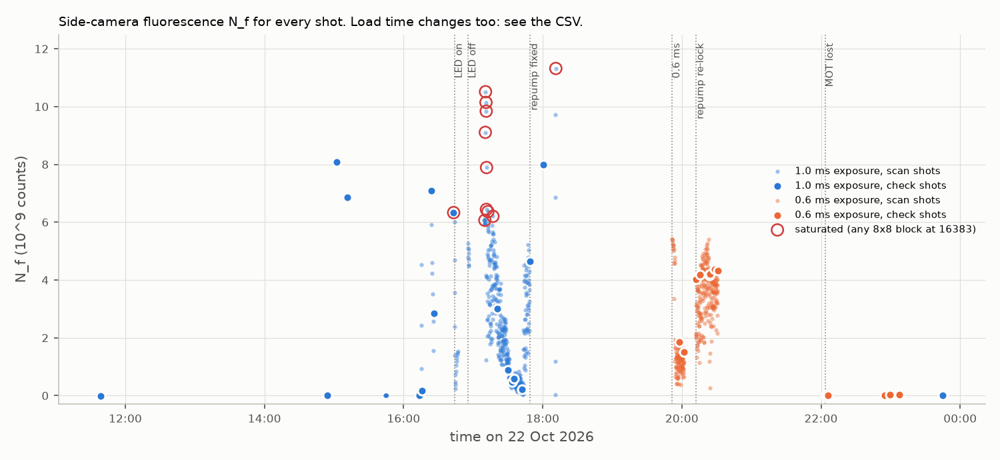
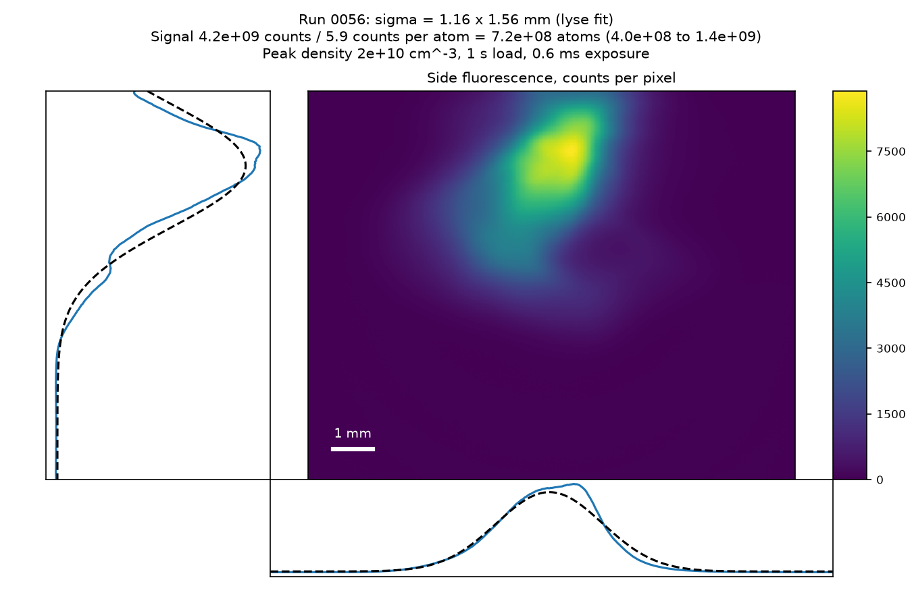
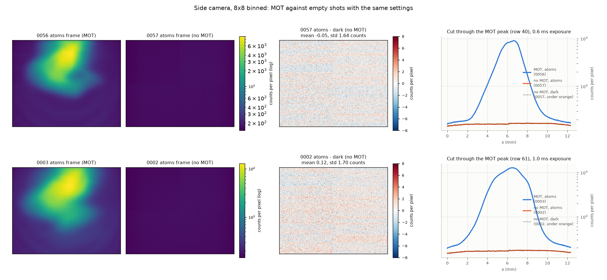
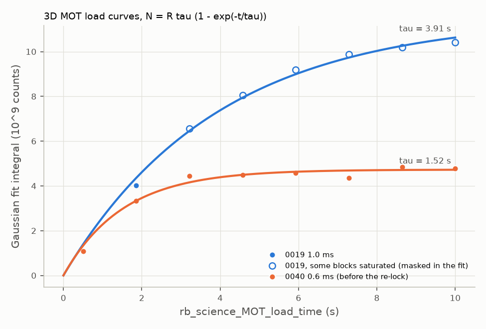
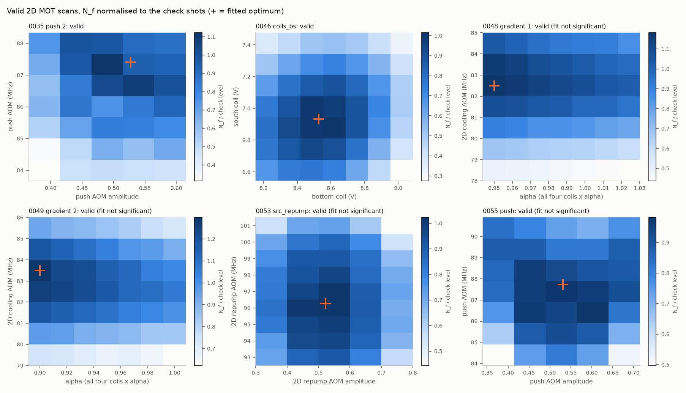
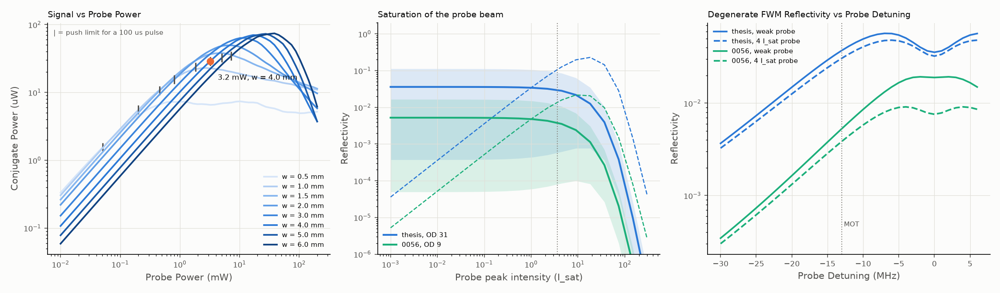

# MOT characterisation and FWM signal estimate from the 22 Oct 2026 run

The scripts read the reduced shot data in `data/2026-10-22` (no lab share). Run them in this order from the repo root:

```
python reports/2026-10-25_mot_characterisation/mot_properties.py   # about 2 min (one Gaussian fit for each shot)
python reports/2026-10-25_mot_characterisation/scan_maps.py
python reports/2026-10-25_mot_characterisation/fwm_model.py --bias-G 3     # about 1 min
python reports/2026-10-25_mot_characterisation/showcase_mot.py       # lyse fit figure of 0056
python reports/2026-10-25_mot_characterisation/extract_frames.py     # camera frames to TIFF and PNG
python reports/2026-10-25_mot_characterisation/mot_vs_empty.py       # MOT against empty shots
```

`showcase_mot.py` runs the plot and fit code of the lyse script `fit_frame_roi.py` without lyse. `extract_frames.py` writes each camera frame to `frames/`. The local frames are 8 × 8 binned. Only the lab shot files on `Z:\` hold full-resolution frames. Use `--files` to read them.

`lab_constants.py` holds every input, with its source and a `confirmed` flag. Run it to print the table. The thesis in the text is S. Tempone-Wiltshire, PhD thesis, Monash University (2019), `localstorage/Seb PhDThesis-6.pdf`. It documents how the apparatus was built.

## Summary

| Question | Answer | Reliability |
|---|---|---|
| 1. Atom number | 7 × 10⁸ atoms after a 1 s load (0056). The plateau is about 2 × 10⁹ (0019). | ±2× (16–84 %: 4 × 10⁸ to 1.4 × 10⁹). The QE and the depumping model set most of this range. |
| 1. Improvement | The repump re-lock gave 2.8×. The evening scans gave +7 %. The evening load rate is 1.6–2.0× the morning rate, but the z bias and τ also changed. | Relative numbers are good to 3 % within one exposure group. |
| 2. Size | σ = 1.16 mm (horizontal) × 1.56 mm (vertical), 0056 | ±15 %. The cloud has two lobes, so a Gaussian is only an approximation. |
| 2. Density, OD | n₀ = 2 × 10¹⁰ cm⁻³, peak OD = 9 (weak resonant probe) | ±2× (it uses N) |
| 2. Temperature | Not measured. Doppler theory gives 0.5 mK. The thesis measured 0.7 mK. | Theory only |
| 2. Lifetime | τ = 3.9 s (morning), 1.5 s (evening, before the re-lock) | ±6 %, ±10 % |
| 2. Quad gradient | 25 G/cm (14 A), from the monitor voltage | Not confirmed (wiring assumption) |
| 3. 2D MOT | Load rate 1 × 10⁹ atoms/s, and the scan optima. No size, number or temperature. | Rate ±2×, optima good where the scan is valid |
| 4. Scan maps | 6 valid 2D scans and 2 valid 1D scans, [figures/scans_valid.png](figures/scans_valid.png) | See Sec. 4 |
| 5. FWM signal | Probe 3.2 mW in a 4 mm waist, 100 µs pulses. Thesis cloud: 29 µW conjugate (R = 0.9 %), 0.72 V on 100 kΩ. Run 0056: 2.4 µW | Order of magnitude (two-level model). Retro-path phases can change it 10–100×. |

## 1. Atom number and how it changed



### From counts to atoms

N_f is the full-frame sum of (atoms − dark) side-camera counts (lyse `fluoro_frame`). `mot_properties.py` converts it to atoms with a photon budget:

1. **Photons per atom.** The fluorescence pulse uses all six MOT beams on resonance, with no repump (`4wavemixing.py:492-494`). The six beams give s = 11 (isotropic I_sat [STECK]). Off-resonant excitation of F′=2 and F′=1 pumps each atom to F=1 after 181 µs, which is about 3000 photons [STECK Table 9, Fig. 3]. So the photon count saturates.
   - 0.6 ms gives 3050 photons, and 1.0 ms gives 3150. The ratio is 1.03 (1.00–1.14). **So morning (1.0 ms) and evening (0.6 ms) N_f compare to within about 10 %.**
   - At this cap, the photon count does not depend much on the beam intensity, so the OD of the cloud has little effect.
2. **Collection.** Ω/4π = 0.70 % [THESIS Sec. 7.5], with an estimated 0.90 transmission.
3. **Camera.** QE = 0.30 at 780 nm (ICX694 typical curve, an estimate) and 0.93 e⁻/count (15,200 e⁻ full well over 16,383 counts at 0 dB [DATASHEET]). The sequence sets no gain, so the camera default (0 dB) applies. Nobody has checked this on the camera.
4. **Result.** 6.2 counts per atom (Monte Carlo 16–84 %: 3.0 to 10.5).

A second route gives a different answer. The absorption calibration `side_rb87_saturation_intensity` = 5262 counts gives 0.13 counts per photon if that calibration used a 30 µs pulse, or 0.020 for a 200 µs pulse. The datasheet route gives 0.29. The pulse time of that calibration is not recorded, so this route stays unresolved. One absorption shot after a time-of-flight drop settles it (Sec. 6).

### Corrections to the earlier reports

- **Saturation costs only a few percent.** Some 8×8 blocks reach the 14-bit ceiling in 0014, 0018, 0019, 0020, 0021 and 0038. The Gaussian fit leaves those blocks out, and its integral agrees with N_f to within 2 % in 0019. So τ = 3.98 s from 0019 holds: the masked fit gives 3.91 ± 0.25 s.
- **The frame clips the cloud, and a halo adds light.** In 0056, 89 % of the fitted Gaussian is inside the frame. The fit offset (13 % of N_f) is diffuse light that scales with the cloud. These two effects cancel to within 5 %, so N_f and the fit integral agree.
- **The cloud is bigger than the moments estimate.** `mot_comparison.py` gives rms 131 × 126 px for 0056. Its ±240 px window cuts off the wings. The 2D fit gives σ = 259 × 347 px. The lyse `fit_frame_roi_fluoro` gives 266 × 358 px.
- **The z bias changes N_f.** 0036 → 0037 changes only `z_bias_MOT_load_current` (0.5 → 0) and `keep_2d_mot_on`. The fit integral rises 1.8×. The 0038 z-bias scan shows that the bias moves the cloud on the camera and changes N.

### Check shots

R_f is the load rate in counts per second, R_f = N/[τ(1 − e^(−t/τ))], from the fit integral. It uses τ = 3.91 s for 1.0 ms shots and τ = 1.52 s for 0.6 ms shots.

| Run | Time | Event | Load (s) | z bias | Fit integral (10⁹) | R_f (10⁹/s) | Atoms (10⁸) |
|---|---|---|---|---|---|---|---|
| 0018 | 17:09 | LED off, stable (median of 8) | 3 | 0.5 | 6.03 | 2.9 | 9.8 |
| 0022 | 17:20 | after coils_tn | 2 | 0.5 | 2.81 | 1.8 | 4.6 |
| 0033 | 17:42 | repump drifted off | 2 | 0.5 | 0.18 | 0.11 | 0.28 |
| 0036 | 17:48 | repump fixed by hand | 2 | 0.5 | 4.41 | 2.8 | 7.1 |
| 0037 | 18:00 | z bias 0, 2D MOT switched off in the shot | 2 | 0 | 7.99 | 5.1 | 12.9 |
| 0044 | 20:01 | before the re-lock | 1 | 0.4 | 1.39 | 1.9 | 2.4 |
| 0045 | 20:12 | after the re-lock | 1 | 0.4 | 3.94 | 5.4 | 6.7 |
| 0056 | 20:30 | end of the evening scans | 1 | 0.4 | 4.23 | 5.8 | 7.2 |

- **Source LED:** on, N_f collapses 25× in 8 shots (0015). Off, the scatter is 1 % (0018).
- **Repump:** the drift cost 16× (0022 → 0033). The re-lock recovered 2.8× (0044 → 0045).
- **Evening scans:** the six check shots 0045–0056 scatter by 2.9 % and rise by 7.3 % in total. The scanned parameters gave at most this +7 %.
- **Morning to evening:** the load rate rose from 2.9 × 10⁹/s (0019, 0036) to 4.8–5.8 × 10⁹/s (0045–0056). The range covers τ = 1.5 s or 3.9 s for the evening. The z bias also changed (0.5 → 0.4), so the scans are not the only cause.

## 2. 3D MOT properties



Run 0056 is the reference MOT. It is the last check shot, with every scan optimum applied. It has no saturated blocks, and the six check shots 0045–0056 agree to 2.9 %. The camera signal is 4.2 × 10⁹ counts. Each atom gives about 5.9 counts (Sec. 1), so the cloud holds 7.2 × 10⁸ atoms.



`mot_vs_empty.py` compares the MOT shots with empty shots that have the same settings (0056 with 0057, 0003 with 0002):

- **No beam light reaches the side camera.** In every empty shot (0002, 0006, 0057–0060), the atoms frame equals the dark frame: atoms − dark is 0.0 ± 0.1 counts per pixel, with a pixel noise of 1.65 counts (8 × 8 block mean).
- **The detection floor is about 10⁵ atoms.** N_f of the empty shots scatters by 4.2 × 10⁵ counts, which is 7 × 10⁴ atoms. The 0056 signal is 10⁴ times larger.
- **The halo comes from the atoms.** Rows 180–275, 4–7 mm below the cloud, carry 39 counts per pixel in 0056 and 0.0 in 0057. So the 13 % halo is atom light: a wide cloud, or MOT light that the cell scatters. It is not light from the beams.



| Property | 0056 (1 s load, 0.6 ms) | Thesis [Sec. 5.4.2] |
|---|---|---|
| Atom number | 7.2 × 10⁸ (4.0 × 10⁸ to 1.4 × 10⁹) | 4 × 10⁹ after 4 s |
| Plateau | 0019: 1.15 × 10¹⁰ counts, so 1.9 × 10⁹ atoms | — |
| σ horizontal × vertical | 1.16 ± 0.17 × 1.56 ± 0.23 mm | widths 2.5 × 1.1 mm (convention not stated) |
| Peak density | 2.2 × 10¹⁰ cm⁻³ (1.2–4.2 × 10¹⁰) | CMOT about 10¹² cm⁻³ |
| Peak OD, weak resonant probe | 8.6 (4.8–16.6) | in-situ OD 10–300 [Sec. 7.3] |
| Temperature | Doppler theory 517 µK at −13 MHz, s = 11 [LETT1989] | 700 µK by time of flight |
| Quad gradient | 14 A, 24.5 G/cm (not confirmed) | optimum 12 G/cm |

- **Size against number.** Across both load curves, σ_vertical grows as N^0.32–0.34. That is the constant-density scaling of a MOT limited by radiation trapping [SESKO1991; TOWNSEND1995]. σ_horizontal grows only as N^0.1.
- **Shape.** The cloud has a second lobe below the main peak, and a sharp edge at x ≈ 7 mm ([figures/cloud_0056.png](figures/cloud_0056.png)). The thesis also calls the cloud shape irregular. The fit residual is 7 % of the peak. Use ±15 % for σ.
- **Blur.** In the 0.5 ms drop, a 0.5 mK cloud expands by 0.11 mm. The recoil random walk adds 0.09 mm. Both change σ by less than 1 %.
- **Lifetime.** The thesis gives ≤ 5 × 10⁻¹² Torr and a magnetic-trap lifetime over 1 min [Sec. 4.2]. So background gas does not set τ. Light-assisted collisions and the 2D MOT atom beam set it. The 0040 load curve (τ = 1.52 s) comes from before the re-lock, so it can be wrong for 0045–0056.
- **Quad gradient.** The Magneato sense voltage is I_coil × R_s / 2000, with R_s = 100 Ω for the quad [THESIS Sec. 4.5.1, App. C]. The thesis does not give R3/R4, so the control-voltage scale stays unknown. The `Quad_voltage` monitor reads 0.70 V. If that is the sense voltage, the coils carry 14 A and give 24.5 G/cm (1.75 G/cm/A, a design value [Sec. 4.4]). That is twice the thesis optimum. This needs a check of the monitor wiring.
- **Imaging bias.** The thesis imaged 40 MHz red, because on resonance the cloud is optically thick and the metric favours large, diffuse clouds [Sec. 5.4.1]. These shots image on resonance. The depumping cap reduces the bias, but it still applies to the scan metric.

## 3. 2D MOT

No sensor sees the source cell. So the data gives only the 3D load rate and the scan optima, not the 2D MOT size, number or temperature.

- **Load rate:** 9.8 × 10⁸ atoms/s (5.5 × 10⁸ to 1.9 × 10⁹), 0056. A Rb 2D⁺ MOT can give 9 × 10⁹ atoms/s [DIECKMANN1998].
- **Detunings** (double pass, Δ = 2f − 180 MHz [THESIS Sec. 4.3]): source cooling −17 MHz, push −5.2 MHz, MOT −13 MHz. The thesis optimum for the 2D MOT was −18 MHz.

## 4. Parameter scans



| Run | Scan | Verdict | Optimum | Detuning | Notes |
|---|---|---|---|---|---|
| 0035 | push | valid | amplitude 0.527, 87.4 MHz | −5.2 MHz | significant fit |
| 0055 | push | valid | 0.531, 87.7 MHz | −4.5 MHz | agrees with 0035. Red detuning is best, as in the thesis. |
| 0046 | coils_bs | valid | bottom 8.53 V, south 6.93 V | — | significant fit |
| 0048, 0049 | gradient | valid | alpha 0.95 and 0.90 (lower edge), 82.5–83.5 MHz | −15 to −13 MHz | not significant. The optimum runs to lower alpha, so scan lower. |
| 0053 | src_repump | valid | amplitude 0.52, 96.3 MHz | −1.4 MHz | on resonance, as in the thesis |
| 0051 | src_trap_amp | valid | 0.466 | — | significant. N_f falls 15× by 0.70. |
| 0038 | z bias | valid | 0.28 | — | the bias also moves the cloud on the camera |
| 0020, 0021 | coils_tn | trend only | top coil at its 10 V limit | — | taken as the drift started |
| 0023–0034, 0041, 0043 | various | spoiled | — | — | repump drift, or before the re-lock |

[figures/scans_spoiled.png](figures/scans_spoiled.png) shows the spoiled maps, and [figures/scans_1d.png](figures/scans_1d.png) shows the 1D scans. `scan_summary.csv` holds all fits.

- **src_trap_amp:** this changes my earlier advice to revert to 0.5. The valid scan 0051 puts the optimum at 0.466. The thesis found that the load rate rises with 2D cooling power up to the maximum. A peak in AOM amplitude can still come from the AOM response, so measure the power against amplitude before you change it.
- **Normalisation:** each scan shot is divided by the check-shot level, interpolated in time. In the valid scans, normalised and raw optima agree.

## 5. Expected FWM signal



`fwm_model.py` takes every input from `lab_constants.py`, which gives a source for each value: the thesis, the lab manual (`labhardware.pdf`), Steck, a datasheet or a user answer. Values from earlier chats (the 10 µW probe, the 8° angle, the 20 nW and 10 nW backgrounds) are gone. The script runs in about 1 min.

The setup diagrams (wave vectors, probe optics, laser frequencies and the double Λ at 3 G) are in [optics/fwm_probe/README.md](../../optics/fwm_probe/README.md#diagrams). `optics/fwm_probe/fwm_diagrams.py` draws them from `fwm_model.json`.

**Model.** Stationary two-level atoms in steady state, with scalar fields [ABRAMS1978; YARIV1977], extended in three ways:
1. All six MOT beams are coherent standing waves with independent phases. The pair on the probe axis writes the main conjugate. The other two pairs also write phase-matched conjugates.
2. The probe enters to all orders, so the model saturates with probe power.
3. The cloud is Gaussian along the probe and across it. The model integrates R over the probe profile.

`fwm_model_check.py` tests the solver against three closed-form limits. With weak pumps, R agrees with the Abrams–Lind result to 0.3 % for OD 0.1–20 [ABRAMS1978; BOYD2008]. With no pumps, the probe follows Beer–Lambert to 1 % up to OD 5. The mean over the pair phases equals the incoherent sum to 0.02 %. A weak-probe solver for a probe at pump + δ agrees with `fwm_model.solve` at δ = 0 to 0.3 %. With weak pumps, it agrees with third-order perturbation theory to 0.1 % [FU1979]. At δ = ±4.2 MHz (the double Λ), the two-level R of a weak probe falls to 0.68× its δ = 0 value for the thesis cloud and to 0.78× for run 0056. A two-level atom has no Raman resonance, so this shows only the cost of the moving grating. These checks test the solver. They do not test the model against a measured FWM signal.

**Inputs.** The default cloud is the thesis MOT: 4 × 10⁹ atoms, σ 2.5 × 1.1 mm, 700 µK, peak OD 31 [THESIS Sec. 5.4.2]. Run 0056 is the second case (OD 8.8). The pumps are the measured MOT beams (s = 11 for all six) at −13 MHz. The probe is at 4° to its MOT axis (user).

**Probe power (out of the ~200 mW available).**
- The conjugate peaks near a probe peak intensity of 10–20 I_sat. Above that, the probe saturates the medium.
- The real limit is the push of the probe on the atoms. A pulse needs 5 AnalogIn samples (100 µs at 50 kS/s). In 100 µs, a probe above 3.6 I_sat Doppler-shifts the atoms by more than Γ/4.
- **Recommended: 3.2 mW at the cloud in a 4 mm 1/e² radius (peak 3.6 I_sat), 100 µs pulses.** A 2.67× Galilean telescope (f = −75 mm, +200 mm) expands the 3 mm beam [THESIS Sec. 4.3.1]. Before PBS B, set 6.5 mW: PBS B sends half to PD ref.
- Thesis cloud: 29 µW conjugate (R = 0.9 %). Run 0056: 2.4 µW.

**Pair phases.** Each pair's conjugate has the phase of its retro path, which drifts. Across the four phase cases the thesis-cloud signal runs from 0.5 to 89 µW. A scalar model overstates this, because the pairs have different polarisations. Expect large shot-to-shot changes. Shutter the other beams in the probe window to remove it, if the hardware allows.

**Detection (PD FWM gets half of the conjugate through PBS A).**
| DET36A/M load | Bandwidth | Signal | Noise | Note |
|---|---|---|---|---|
| 1 MΩ | 4 kHz | 7.2 V | 0.24 nW | too slow for 100 µs, saturates in the best phase case |
| **100 kΩ** | **40 kHz** | **0.72 V** | **0.8 nW** | **use this** |
| 10 kΩ | 400 kHz | 72 mV | 3 nW | |

Backgrounds: MOT fluorescence through a mode-matched pinhole is 0.08 nW. The polarisation leak of the λ/4 reflections past PBS B is 16 nW. The detector does not set the floor. The pair phases and the MOT number (2.9 % jitter gives 3.4 % on R) set it.

**Two beams for a lower floor?** The transmitted probe and the conjugate are twin beams. But the gain is G = 1.009, so their intensity difference is 0.98 of shot noise [MCCORMICK2007]. A difference measurement gives no useful noise reduction. Use the far-side photodiode as a monitor instead: its absorption gives the OD of each shot, and the conjugate scales as OD^1.2 here. Divide by it, and divide by PD ref for the probe power.

**Zeeman resonance (design numbers only).**
- Switch the quad off first: at 14 A it spreads the field by 6 G over 1 σ of the cloud.
- Apply 3 G along the probe's MOT axis: I_X = −0.34 A, I_Y = +1.66 A [THESIS Sec. 4.4.6, 6.25 and 1.28 G/A]. The bias Magneato A/V is not documented. Measure it with a clamp ammeter ([LABHW] p. 17 does this for the quad).
- The Δm = 2 ground-state resonance is at δ = ±4.2 MHz (2 × 0.70 MHz/G × 3 G). With the trap AOM at 83.5 MHz, set `imaging_push_aom` to 85.60 or 81.40 MHz.
- The MOT beams pump the atoms, so the width is about 2.2 MHz. The two-level model cannot predict the height of this resonance.

**Limits.** No Zeeman sublevels in the signal model, a scalar field, no pump depletion or retro shadow. The width convention of the thesis cloud is not stated, so the OD can be up to 4× higher. Use the model to choose the probe and the detector, not to predict an exact signal.

## 6. Open measurements

1. **Absorption after a 5–10 ms drop.** This calibrates N (in-situ OD 10–300 is too high [THESIS Sec. 7.3]). Record the pulse time of the I_sat calibration.
2. **Time of flight, 1–10 ms.** This gives the temperature (`analysis/lyse/multishot/fit_temperature_fluoro.py`).
3. **Load curve after the re-lock.** This gives the evening τ.
4. **Power against AOM amplitude** for the 2D cooling (`rb_source_MOT_trap_amplitude`) and for `science_trap_aom` at 0.45 and 0.5.
5. **Camera.** Read the gain in the IMAQdx attributes. Steer the camera so the cloud is not cut at the top of the frame. Consider fluorescence imaging 40 MHz red, as in the thesis.
6. **Quad monitor.** Find which Magneato node `Quad_voltage` reads. That confirms or corrects the 25 G/cm estimate.

## References

- [THESIS] S. Tempone-Wiltshire, "Development of a rapid Rubidium-87 Bose Einstein Condensate apparatus", PhD thesis, Monash University (2019). Ch. 4, 5, 7 and App. C.
- [STECK] D. A. Steck, "Rubidium 87 D Line Data", rev. 2.3.4 (2025). Tables 3, 7, 9 and Fig. 3.
- [DATASHEET] Allied Vision Prosilica GT2750 datasheet and technical manual (Sony ICX694).
- [LETT1989] P. D. Lett et al., J. Opt. Soc. Am. B 6, 2084 (1989).
- [SESKO1991] D. W. Sesko, T. G. Walker, C. E. Wieman, J. Opt. Soc. Am. B 8, 946 (1991).
- [TOWNSEND1995] C. G. Townsend et al., Phys. Rev. A 52, 1423 (1995).
- [DIECKMANN1998] K. Dieckmann et al., Phys. Rev. A 58, 3891 (1998).
- [ABRAMS1978] R. L. Abrams, R. C. Lind, Opt. Lett. 2, 94 (1978), errata Opt. Lett. 3, 205 (1978).
- [YARIV1977], [ZHAO2009], [BOYD2008], [DUCLOY1984]: see `analysis/probe_angle/max_probe_angle.py`.
- [ZHOU2010] Zhou et al., Chin. Phys. Lett. 27, 014211 (2010). Backward FWM in an ⁸⁷Rb MOT.
- [LABHW] BEC Lab User Manual, "iii. Hardware" (2019), `labhardware.pdf` in the repo root.
- [LEZAMA2001] A. Lezama, G. C. Cardoso, J. W. R. Tabosa, Phys. Rev. A 63, 013805 (2001).
- [MCCORMICK2007] C. F. McCormick, V. Boyer, E. Arimondo, P. D. Lett, Opt. Lett. 32, 178 (2007).
- [FU1979] T. Y. Fu, M. Sargent III, "Effects of signal detuning on phase conjugation", Opt. Lett. 4, 366 (1979). Two-level FWM with a detuned probe. The weak-field form in `fwm_model_check.py` comes from the Bloch equations, not from a line-by-line comparison with this paper.
- [DET36A], [THORLABS-B], [THORLABS-PBS]: Thorlabs spec sheets, see `lab_constants.py`.
